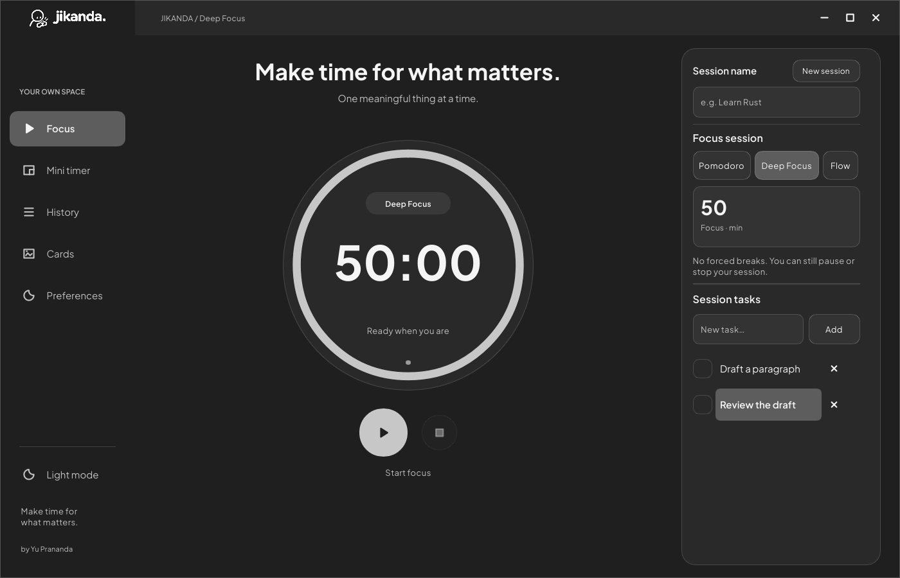
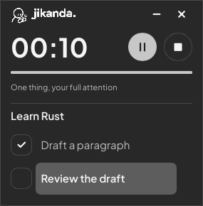
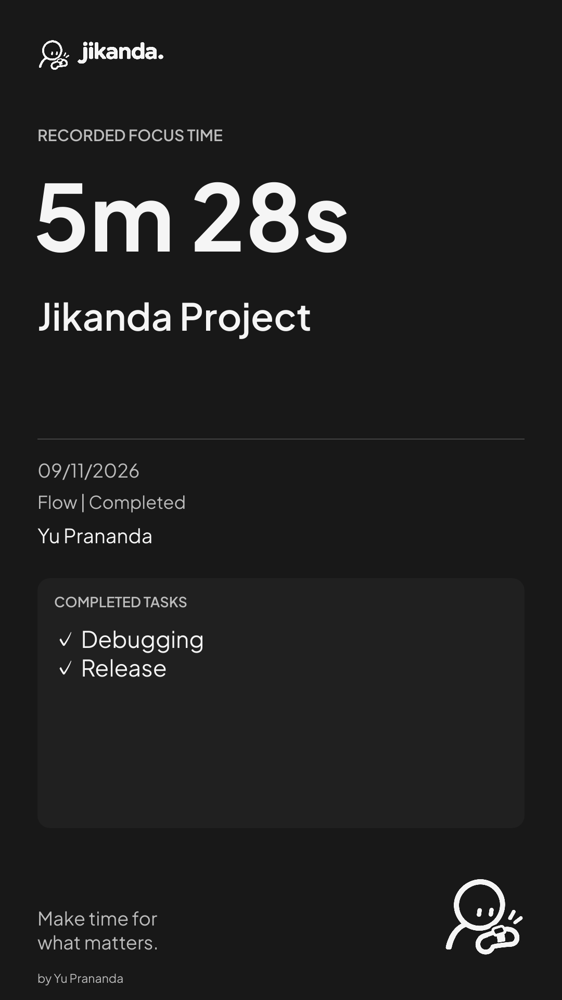

<p align="center"></p>

# Jikanda

**Make time for what matters.** - by Yu Prananda

A calm desktop focus companion built with **Rust and Slint**. Local-first,
open source, and available in English and Bahasa Indonesia. No account, cloud
service, analytics, or activity tracking.

**Windows beta | GPL-3.0-only**

[Downloads](https://github.com/yuprananda/jikanda/releases) |
[Installation](docs/installation.md) | [Panduan Indonesia](docs/installation-id.md) |
[Report a bug](https://github.com/yuprananda/jikanda/issues)



## Make room for a session

- **Pomodoro:** 25-minute focus, 5-minute breaks, four focus segments. Start each
  segment when ready. Breaks are excluded from recorded focus time.
- **Deep Focus:** one 50-minute countdown without forced breaks.
- **Flow:** count up until you explicitly finish and save.
- Name a session and keep a small checklist without deadlines.
- Pause/resume or explicitly save/discard an interrupted session.
- Keep a compact, draggable mini timer nearby; opacity is available on Windows.
- Review daily/weekly totals and correct or delete local history.
- Export a saved session as an offline Story (1080x1920) or Feed (1080x1350) PNG.
  Display name and completed tasks are optional; private notes are excluded.
- Choose from three original short alarm sounds, preview them, or turn them off.
  Alarm and desktop notification settings are independent.
- Monochrome light/dark UI; English is the default language.

Recorded session time is not verified productivity or concentration. Sleep/time
uncertainty pauses the session; active sessions are not credited after a crash or
restart. See [time and storage behavior](docs/privacy-and-storage.md).

| Mini timer | Share card with example data |
| --- | --- |
|  |  |

## Install the Windows beta

1. Download `Jikanda-0.1.0-beta.1-windows-x64.zip` from the release assets when published.
2. Extract the whole ZIP to a permanent folder, such as `%LOCALAPPDATA%/Programs/Jikanda`.
3. Run `jikanda.exe`. The optional `install-windows.ps1` creates a Start menu shortcut.

Windows 11 x64 is the tested desktop platform. The beta is unsigned; verify the
release source and SHA-256 if Windows displays a reputation warning. Windows 10,
ARM64, and Linux desktop behavior are not validated for this beta. No administrator
access or startup service is required. See the installation guides above for updates,
uninstalling, audio, notifications, and checksums.

## Build from source

Use Rust stable **1.92+** and a native linker. Windows requires MSVC C++ Build Tools
and the Windows SDK. A separate release source archive includes vendored Cargo
crates for offline builds.

```sh
cargo build --release --locked
cargo run --release --locked
```

For the vendored source archive, use `cargo build --release --locked --offline`.
See [building and release checks](docs/building.md). There is no browser runtime,
web server, or application network backend.

## Local data

Windows stores settings/history in `%LOCALAPPDATA%/Jikanda`. Linux source builds use
`$XDG_DATA_HOME/jikanda`, otherwise `~/.local/share/jikanda`. Find the exact folder
in Preferences > Storage. Exports default to its `exports` subfolder.

Data is local JSON, with atomic saves and single-instance locking. Updating the
executable keeps your data. Uninstalling does not delete history. Back up
`state.json` before testing a beta. [Privacy and storage](docs/privacy-and-storage.md).

## Status and contributing

This is an early Windows beta. Multi-monitor/DPI variations, physical sleep/resume,
assistive technology, Windows 10, and Linux X11/Wayland need broader device testing.
Wayland can restrict topmost/positioning; Linux opacity is unavailable.
[Known limitations and test evidence](docs/release-readiness.md).

Report issues with app version, OS, scaling, steps, and expected behavior. Remove
personal names, tasks, and paths from screenshots. See [CONTRIBUTING](CONTRIBUTING.md).

## License and credits

Jikanda is **GPL-3.0-only**, using Slint through its GPLv3 option. Plus Jakarta Sans
retains **SIL OFL 1.1**. Maintainer-supplied brand art is reused without redrawing the
mascot. Alarm WAVs are original synthesized signals, with their generator under
GPL-3.0-only. Notices and a corresponding source archive accompany the Windows beta.

[LICENSE](LICENSE) | [LICENSING](LICENSING.md) | [Brand and icons](docs/brand/README.md)
